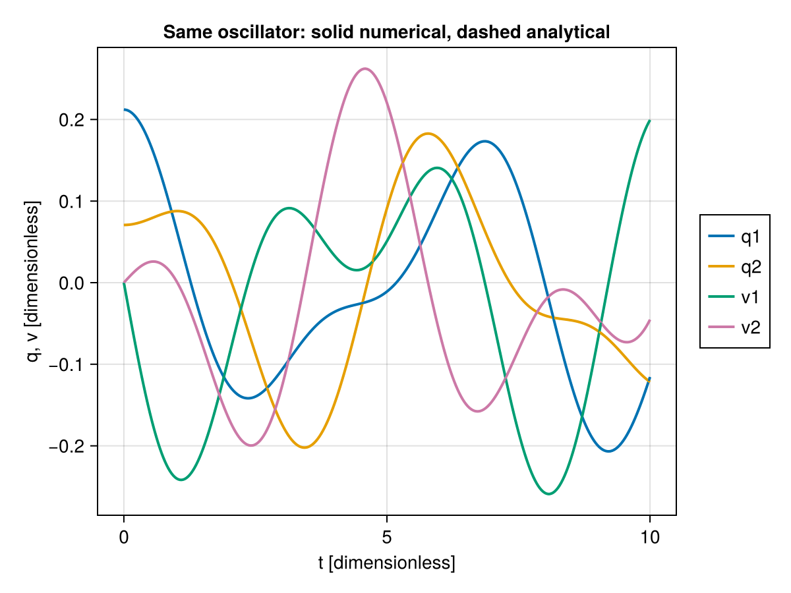

# One system, many methods: an evidence-driven investigation

[Learning path](index.md) · Previous: [atomistics](atomistics.md)

Prerequisites: calculus, mechanics, normal modes, ODEs and stored-sample statistics.
Difficulty: integrative. Direct dependencies of the unchanged canonical example:
AnalyticMathLab, Symbolics and LinearAlgebra, all in the root project. Optional
learning/rendering are not prerequisites. The wrapper imports AnalyticMathLab.
Executable: [small verification wrapper](scripts/one_system_many_methods.jl), reusing
[the authoritative implementation](../../examples/integration/one_system_many_methods.jl).
From the repository root, either verified command works:

```sh
julia +1.12.7 --project=. docs/tutorials/scripts/one_system_many_methods.jl
```

```sh
julia +1.12.7 --project=. examples/integration/one_system_many_methods.jl
```

## Declare the physical system once

The canonical system uses dimensionless $m=k=\kappa=1$, ordered coordinates
$(q_1,q_2)$, velocities $(v_1,v_2)$ and state $(q_1,q_2,v_1,v_2)$. The potential,
kinetic energy and Lagrangian are

$$V=\tfrac12(q_1^2+q_2^2)+\tfrac12(q_2-q_1)^2,\quad
T=\tfrac12(v_1^2+v_2^2),\quad L=T-V.$$

Mass and stiffness are $M=I$, $K=\begin{pmatrix}2&-1\\-1&2\end{pmatrix}$.
Anchor stiffness, positive masses and conservative coupling make this a smooth,
linear system about $(0,0)$, not a general nonlinear stability study.
No physical unit conversion is implicit. The model's chosen amplitude and initial
velocity conventions must stay fixed when comparing mathematical routes.

## Derive an independent reference before integrating

The symmetric/antisymmetric basis
$\Phi=\frac1{\sqrt2}\begin{pmatrix}1&1\\1&-1\end{pmatrix}$ gives
$\omega=(1,\sqrt3)$. The modal displacement amplitudes are $(0.20,0.10)$;
initial modal velocities vanish. Consequently,

$$q(t)=\Phi\begin{pmatrix}0.20\cos t\\0.10\cos(\sqrt3t)\end{pmatrix},\qquad
v(t)=\Phi\begin{pmatrix}-0.20\sin t\\-0.10\sqrt3\sin(\sqrt3t)\end{pmatrix}.$$

Direct substitution verifies $M\ddot q+Kq=0$ and the declared initial state.
The conserved analytical energy is
$\frac12(1\cdot0.20^2+3\cdot0.10^2)=0.035$.
`exact_state` builds this formula without AML eigenvectors or numerical states.
That independence makes it a reference oracle rather than a second presentation
of the solver's own answer.

## Walk through the unchanged implementation

Read `canonical_system` and `investigate` in the linked script; no hundreds of
lines need be copied into this page.

1. **Potential and derivatives.** `analyze(V,q)` yields $\nabla V=Kq$ and
   $\nabla^2V=K$. At the origin the force $-\nabla V$ vanishes.
2. **Lagrangian mechanics.** `analyze(LagrangianSystem(...))` supplies EL residuals.
   `linearize_mechanics` gives $M,C=0,K$; here the local model is exactly the
   declared linear system.
3. **Modes.** `normal_modes(linearization)` recovers the independently derived
   frequencies. Mass orthogonality and eigenpair residuals are checked.
4. **Hamiltonian route.** The established affine `legendre_transform` gives
   $H=\frac12p^Tp+V$. Phase order is $(q_1,q_2,p_1,p_2)$, and conversion is
   explicitly $p=mv$, not an unannounced reinterpretation of the velocity state.
   Sampled Hamilton equations are checked against $(v,-Kq)$.
5. **Numerical evolution.** `dynamics(lagrangian)` and `trajectory` integrate the
   same initial state over $[0,10]$ with absolute/relative solver tolerances $10^{-8}$.
   The script checks the exact binary observation grid `0:0.03125:10`; it refuses
   additional saved points instead of silently resampling. This is a bounded
   model-specific observation, not a general `saveat` guarantee.
6. **Stored observations.** Explicit q1/q2, energy and symmetric-mode selectors
   create series; summaries describe finite observations. Standard errors remain
   unavailable, not zero. Mean energy is not itself a conservation proof.
7. **Particle interpretation.** Five saved frames are explicitly mapped to
   anchored particles at $(0+q_1,0,0)$ and $(1+q_2,0,0)$ with velocities
   $(v_i,0,0)$, fixed IDs `left,right` and open geometry. The equilibrium anchor
   separation 1 matters: pair distance is $|1+q_2-q_1|$, not $|q_2-q_1|$.
   This is a caller-declared interpretation, not an automatic ODE-to-atom adapter.
8. **Experimental dataset.** `ScientificDataset(path; schema, source_retention=:descriptor)`
   selects q1 with input name `symmetric_amplitude`, coordinate name `t`, explicit
   training split, deterministic RNG declaration and numerical reference of unknown
   error. Fixed constants and the antisymmetric amplitude remain caller context.
   An exact data-selection check does not upgrade those targets to analytical truth.

## Execute and check the workflow

This full block is the minimal wrapper, identical to its linked script. The model
and numerical implementation remain solely in the canonical example.

```julia
using AnalyticMathLab

# Root-relative include; authoritative model and implementation remain unchanged.
include(joinpath(pwd(), "examples/integration/one_system_many_methods.jl"))
r = OneSystemManyMethods.investigate()
@assert r.system.state_order == (:q1, :q2, :v1, :v2)
@assert r.system.phase_order == (:q1, :q2, :p1, :p2)
@assert r.path.solution.t == r.system.times
@assert r.metrics.saved_points == 321
@assert length(r.comparisons) == 12 && all(c.agreement for c in r.comparisons)
@assert r.metrics.trajectory_error <= 2e-8
@assert r.metrics.energy_oracle_error <= 2e-9
@assert only(r.dataset.samples).values == r.series.q1.values
@assert r.statistics.q1.value.standard_error === nothing
# These packages must not activate optional AML extensions in this base workflow.
extensions = (:AnalyticMathLabMollyExt, :AnalyticMathLabInferenceExt,
    :AnalyticMathLabDynamicsExt, :AnalyticMathLabSurrogateExt, :AnalyticMathLabPINNExt)
@assert all(e -> Base.get_extension(AnalyticMathLab, e) === nothing, extensions)
println((metrics=r.metrics, comparisons=length(r.comparisons),
    dataset_reference=r.schema.reference, optional_extensions=:not_loaded))
println("ONE_SYSTEM_MANY_METHODS_OK")
```

## New execution evidence and numerical interpretation

EXAMPLE_EXECUTED: both commands above ran again in M10D.6C, not merely during
M10D.6B. There were 321 saved samples and 12 successful cross-method comparisons.
The newly observed maximum state discrepancy was `4.335370951125128e-11`,
checked against $2\times10^{-8}$. Analytical energy discrepancy was
`1.0833993424608224e-11`, checked against $2\times10^{-9}$; sampled energy drift
was `1.083398648571432e-11`. Mode residual and Hamilton flow discrepancy were 0;
mass-orthogonality discrepancy was `2.220446049250313e-16`.

NUMERICAL_COMPARISON: the principal metric is the entrywise maximum difference
between all ordered saved states and independently computed reference states at
the same times. The canonical comparison contracts require the same model,
parameters, quantity, coordinate/state order, amplitude, units and sample locations.
Most algebra/modal comparisons use $10^{-13}$; trajectory/selected-coordinate/
particle-reference comparisons use $2\times10^{-8}$, energy-reference comparisons
$2\times10^{-9}$, and dataset selection is checked exactly. Agreement does not
supply a rigorous global error bound or validate a different physical model.

HISTORICAL_VERIFICATION: M10D.6B recorded the same sample count and bounded
metrics; that older evidence remains frozen. The full 5,649-test M10D.5 canonical
is historical only and was not rerun here.

## Evidence and provenance are different axes

Qualified **experimental** `AnalyticMathLab.scientific_origin` records process-local
source ancestry. Stored q1 legitimately descends from the trajectory, mechanical
conversion and Lagrangian report; the dataset descends from the same trajectory.
The independent analytical oracle describes the same model but does not descend
from the numerical path. Scientific value equality does not create ancestry.
Isolated statistical PropertyResult leaves have unavailable ancestry: keep the
source series explicitly. Metadata describes declarations, not physical certification;
origin tokens are not durable identity hashes.

## Reused visualization and optional directions



This is the unchanged M10D.6B CairoMakie asset, not a new M10D.6C render. The two
solutions nearly coincide at this scale; absence of visible separation is not an
error bound. The [README visualization instructions](../../README.md#scientific-visualization)
remain the historical verified reproduction route with an explicit backend.
Mathematical execution above requires no rendering backend.

Core calculus, mechanics, trajectories and statistics remain stable. Scientific
Dataset and qualified metadata/origin are experimental even though callable in
the base environment. No optional AML extension was loaded by the verified wrapper.
The existing [one-step learning demonstration](../../examples/integration/one_system_learning.jl)
is a pipeline example, not an accuracy or generalization claim; it was not run here.
For separate assumptions and optional projects, consult
[learned dynamics](../learned_dynamics.md), [inference](../parameter_inference.md),
[PINNs](../scientific_ml.md), [surrogates](../surrogates.md) and the
[operator guide](../operator_backends.md). Their optional environments are linked
from the [tutorial index](index.md); do not install all stacks for this lesson.
No training loss certifies physical validity, optimizer convergence or PDE correctness.

## Limitations and next steps

This is one deterministic linear dimensionless model, not a general force-field,
nonlinear stability, uncertainty or large-scale scalability study. Dense modes
remain dense; solver history is retained; descriptive statistics do not infer IID
uncertainty. Dataset schema assertions about closure parameters are caller
assertions, not automatic discovery. Read the existing
[model guide](../m10d_one_system_many_methods.md),
[evidence semantics](../m10d_semantics.md) and [provenance guide](../m10d_provenance.md)
for contract details. A full public reference and documentation infrastructure
require separate authorization.
[Execution record](../../reports/m10d6/tutorial_implementation_report.md).
